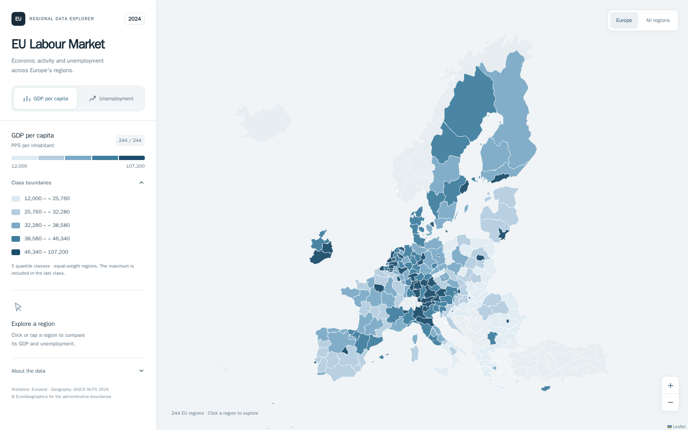
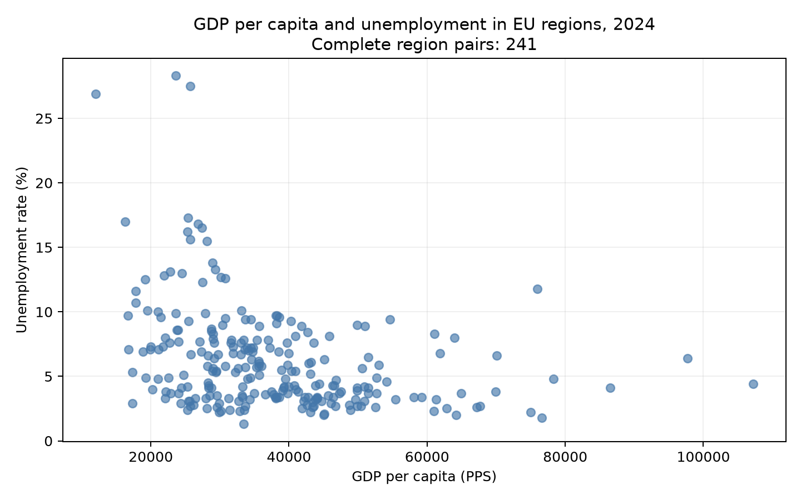

# European Regional Labour Market

An independent Data Analyst portfolio project examining GDP per capita and
unemployment across EU regions in 2024, using the Eurostat API and GISCO.

**Status:** data preparation, exploratory analysis and the interactive map are
completed locally. Public deployment and selection of a code license remain pending.

## Interactive map

Open [`docs/index.html`](docs/index.html) in a browser, keeping its adjacent
`assets/vendor/` directory. The map works without an internet connection.
It has synchronized GDP/unemployment colors and legends, touch-friendly region
details, observation flags, missing-value styling and an all-regions view.

[](docs/index.html)

On a phone, controls sit above and below the map instead of covering it.
The class key is initially collapsed; selecting a region shows its values in
the lower panel. On desktop, the same controls live in a sidebar.

## Research question and findings

Are EU NUTS 2 regions with higher GDP per capita in purchasing power standards
associated with lower unemployment rates?

The verified NUTS 2024 geography contains 244 regions in the 27 EU Member States.
GDP is available for all regions; unemployment is missing for Trier, Lubuskie
and Åland. The analysis uses 241 complete region pairs, with equal regional weights.

| Sample | Regions | Spearman rho | Pearson r |
|---|---:|---:|---:|
| All complete pairs | 241 | -0.378 | -0.336 |
| Excluding unemployment flag `u` | 222 | -0.387 | -0.338 |

Higher regional GDP per capita is associated with lower unemployment, with
substantial variation. The result is similar after excluding low-reliability
unemployment observations. This is a cross-sectional association, not a causal
or individual-level conclusion. GDP per capita is not residents' income.



Read the [analysis report](reports/report.md), [source definitions](docs/DATA_SOURCES.md)
and [validation documentation](docs/VALIDATION.md).

## Reproduce locally

Tested on Debian 13 with Python 3.13.5. From the project directory:

```bash
python3 -m venv .venv
source .venv/bin/activate
python -m pip install -r requirements.lock
```

`requirements.txt` lists direct dependencies; `requirements.lock` records the
complete installed environment. The lock file is a pinned environment snapshot,
not a cross-platform compatibility guarantee.

In VS Code, select the project `.venv` interpreter and notebook kernel, then run:

1. [API, metadata and preparation](notebooks/01_api_and_metadata.ipynb).
2. [Exploratory analysis](notebooks/02_exploratory_analysis.ipynb).
3. [Interactive map](notebooks/03_interactive_map.ipynb).

All three notebooks run independently
of previous kernel state, from within the project directory. Preparation reads
preserved API responses by default; analysis reads the derived CSV. No new API
calls are required. The first notebook includes an explicitly disabled online
request example, which does not overwrite the snapshots.

To verify file integrity, rerun all three notebooks offline in temporary copies and
compare regenerated artifacts:

```bash
python scripts/verify_project.py
```

## Repository contents

- `data/raw/`: six preserved source responses, never edited during analysis.
- `data/metadata/`: source URLs, acquisition information and SHA-256 checksums.
- `data/processed/`: the 244-row analysis CSV, including flags and missing values.
- `notebooks/`: preparation, exploratory analysis and map generation.
- `reports/`: report, figures and computed tables.
- `docs/`: static map page, local Leaflet assets, definitions and validation documentation.
- `map_assets/`: maintained map layout, styles and browser interactions.
- `scripts/`: map renderer and offline reproducibility verification.

The project demonstrates API/JSON-stat inspection, reference-geography validation,
one-to-one joins, missing-data and flag handling, visualization and sensitivity
analysis. Geography is selected using verified codes, not by dropping missing values.

The map can also be regenerated directly:

```bash
python scripts/build_map.py
```

Edit the map source files or renderer, then regenerate. Do not patch the generated
HTML. Optional browser checks are in `scripts/check_map.cjs` and require Node.js
with Playwright available; they are not required for Python data reproduction.

## Sources and reuse

Eurostat datasets: `lfst_r_lfu3rt` and `nama_10r_2gdp`; geography reference:
Eurostat GISCO NUTS 2024. See [data provenance and reuse notes](data/README.md).
A code license has not yet been selected. No license for third-party data is
implied by the repository's code. Source attribution and geographic-data terms
must be retained when publishing the map.

## Motivation

I want to strengthen my skills in API-based data acquisition, data cleaning and
statistical analysis, and build a reproducible project with an interactive map.
