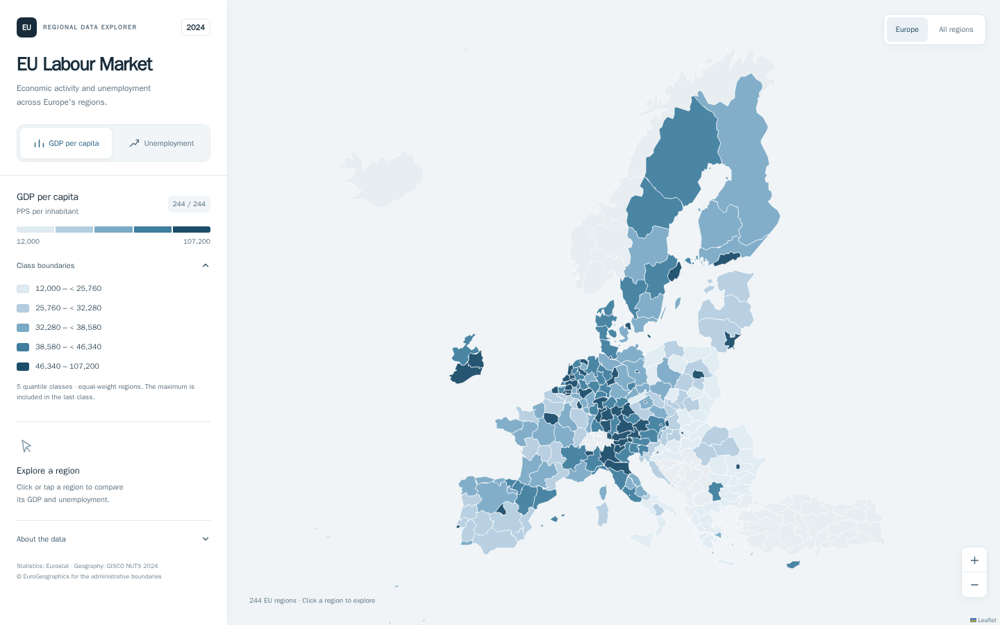
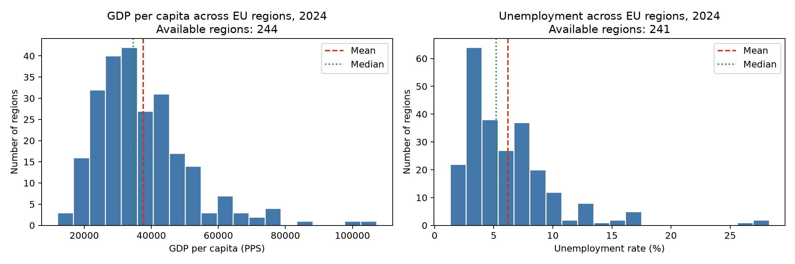
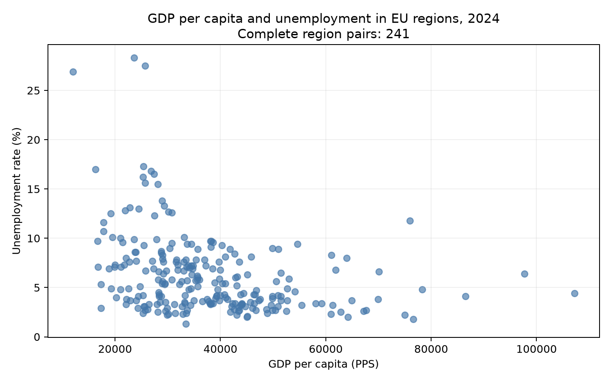

# GDP per Capita and Unemployment Across EU Regions, 2024

## Research question

Are EU NUTS 2 regions with higher GDP per capita in purchasing
power standards associated with lower unemployment rates?

## Data and coverage

The study uses Eurostat data for 2024 and the NUTS 2024 geography
for the 27 EU Member States.

- Reference regions: 244.
- Regions with GDP per capita data: 244.
- Regions with unemployment data: 241.
- Complete pairs used in the correlation analysis: 241.

Unemployment data are unavailable for Trier (DEB2), Lubuskie (PL43)
and Åland (FI20). These missing values were preserved.

The indicators are annual unemployment rates for persons aged
15–74 and GDP per capita in purchasing power standards (PPS).

## Methods

Regions receive equal weight. Spearman correlation is the primary
measure of association, with Pearson correlation as a complementary
measure of linear association.

A sensitivity analysis excludes observations whose unemployment
status contains the low-reliability flag `u`. GDP observations
marked as provisional (`p`) or estimated (`e`) are retained.

## Results

| Sample | Regions | Spearman rho | Pearson r |
|---|---:|---:|---:|
| All complete pairs | 241 | -0.378 | -0.336 |
| Excluding unemployment flag u | 222 | -0.387 | -0.338 |

Regions with higher GDP per capita tend to have lower unemployment
rates, with substantial variation around this overall pattern.

Excluding unemployment observations flagged for low reliability
produces similar coefficients.

This sensitivity check concerns only the unemployment `u` flag. It does not
establish robustness to country differences, extreme observations or other flags.

## Descriptive context

Across the 244 available GDP observations, the mean is 37,555.33 PPS per
inhabitant and the median is 34,650 PPS. Across the 241 available unemployment
observations, the mean regional rate is 6.20% and the median is 5.20%.
These are unweighted summaries of regional indicators, not official EU aggregates.

## Visualizations

The [interactive regional map](../docs/index.html) displays all 244 regions with
separate GDP and unemployment views. It retains unavailable values and flags,
uses indicator-specific quintile classes and includes an all-regions extent.
Open the page with its adjacent local Leaflet assets; it requires no network.

## Limitations

- The analysis is observational and does not establish causation.
- Regional relationships do not describe individual outcomes.
- GDP per capita measures economic activity, not residents' income.
- PPS conversion uses national PPPs and does not separately adjust
  for price differences between regions within a country.
- Unemployment estimates are survey-based; observation flags matter.
- GDP values include provisional and estimated observations.
- Unemployment flags `b` and `d` are retained; the underlying national
  methodological differences have not been fully assessed.
- Country differences, spatial dependence and the influence of
  extreme observations have not been separately modelled.
- The results describe 2024 and do not establish a relationship
  over time.

## Sources

- Eurostat unemployment dataset: `lfst_r_lfu3rt`.
- Eurostat regional GDP dataset: `nama_10r_2gdp`.
- Eurostat GISCO: NUTS 2024 reference geography.

Acquisition details and file checksums are documented in
[`acquisition_manifest.json`](../data/metadata/acquisition_manifest.json).
Definitions and scope checks are documented in
[`DATA_SOURCES.md`](../docs/DATA_SOURCES.md).
